# 05 – Flytskjema, prosessbygger og automatiske arbeidsflyter

**Hvert diagram er en produktmal, ikke en obligatorisk ISO-prosedyre.** Kundens prosesseier må kunne redigere, teste, godkjenne og publisere maler. Mermaid her dokumenterer ønsket prosesslogikk; produksjonseditor bruker en egen sikker grafmodell.

## P01 – Ledelsessystemets helhetlige PDCA-syklus
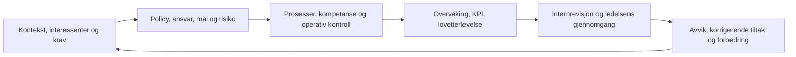

## P02 – Avviksbehandling (kjørbar)
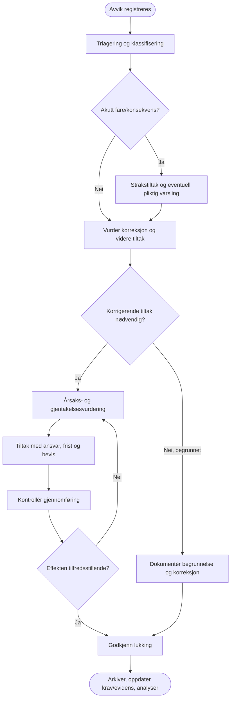

**Bind:** A→SF16, B→rolle kvalitet/HMS, D→oppgave/beredskap, G→SF17, H→SF18, J→SF18-effekt, K→låst auditrecord og kravbevis. Behandle sensitiv HMS-informasjon med særtilgang. Ikke påstå at systemet melder automatisk til offentlige myndigheter uten konkret integrasjon.

## P03 – Prosessdesign og publisering
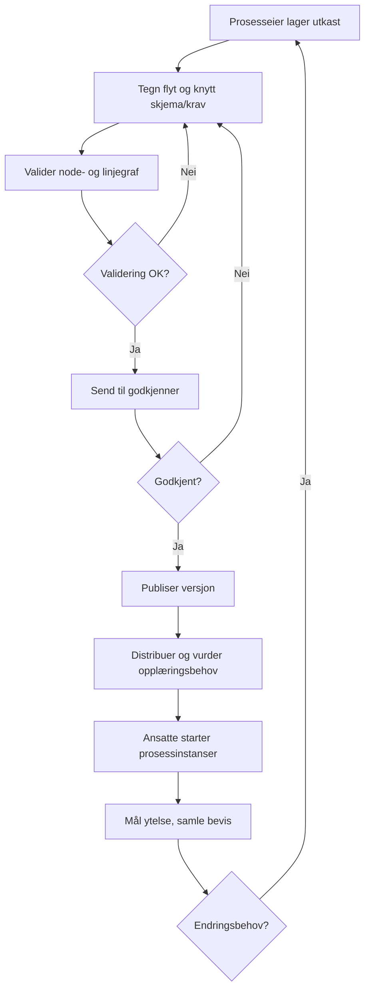

## P04 – Kundekrav → tilbud → kontrakt → prosjekt
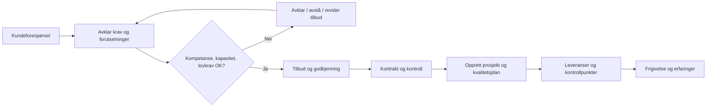

## P05 – Prosjektering og fagkontroll
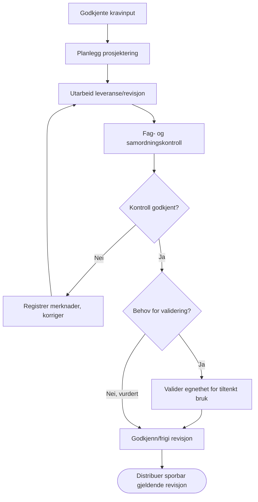

## P06 – Risikovurdering og tiltak
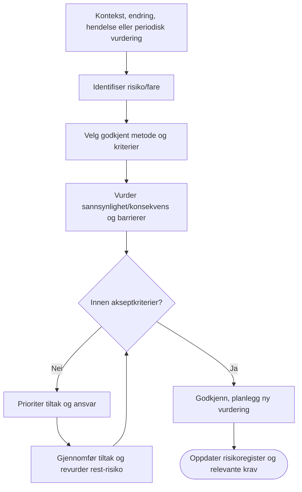

## P07 – Miljøaspekt og samsvarsforpliktelser
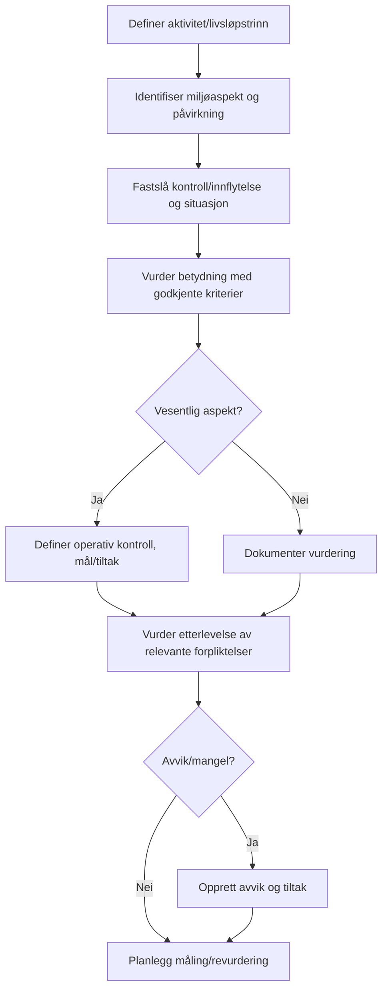

## P08 – Kompetanse og autorisasjon
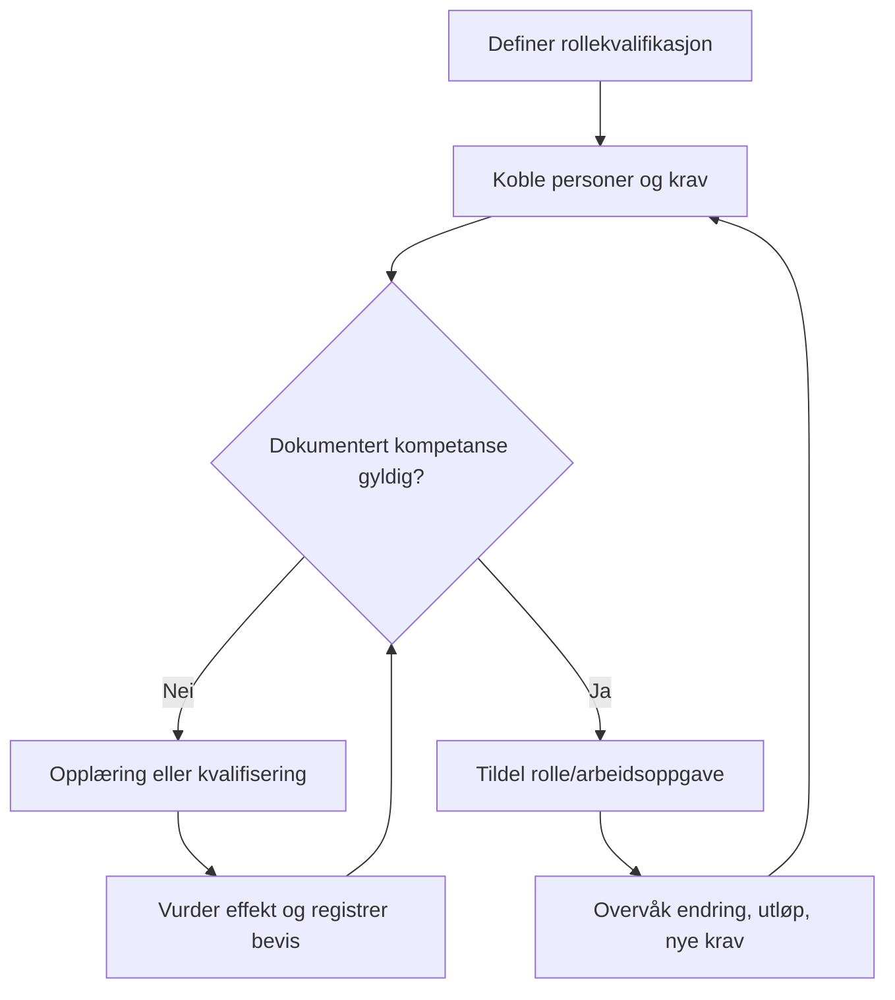

## P09 – Styrt dokumentrevisjon
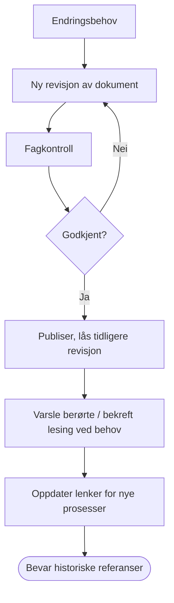

## P10 – Internrevisjon → tiltak
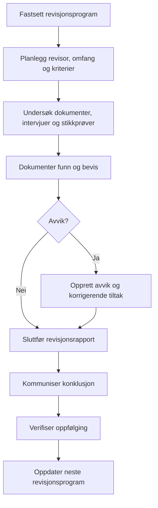

## P11 – Ledelsens gjennomgang
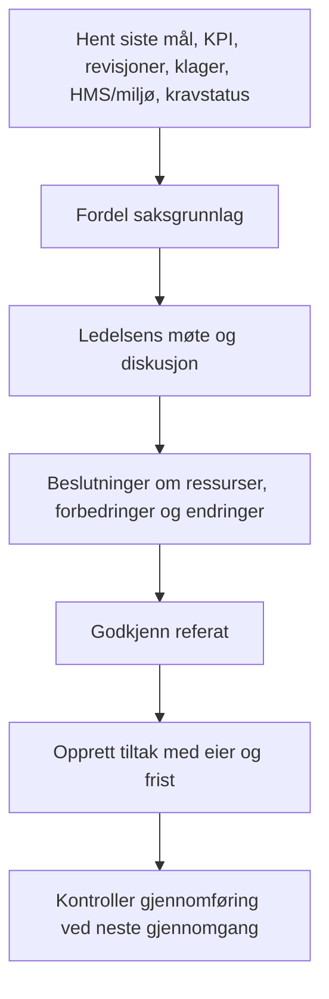

## P12 – Beredskap/øvelse
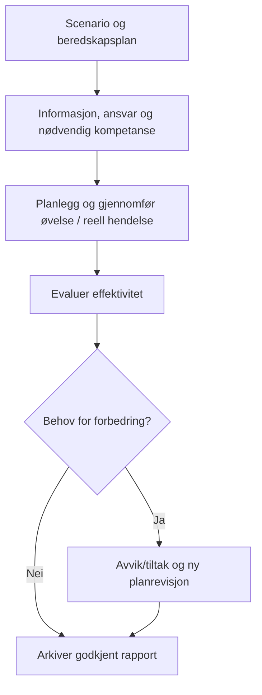

## P13 – Leverandørstyring
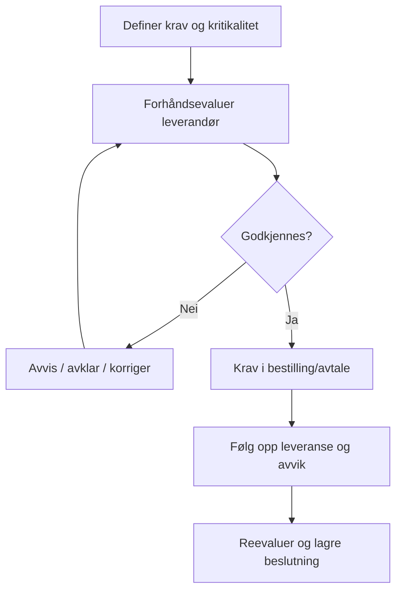

## P14 – Prosesslandskap (navigasjon, ikke automatikk)
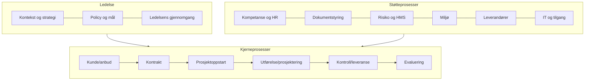

## P15 – Aktiv prosess med swimlanes
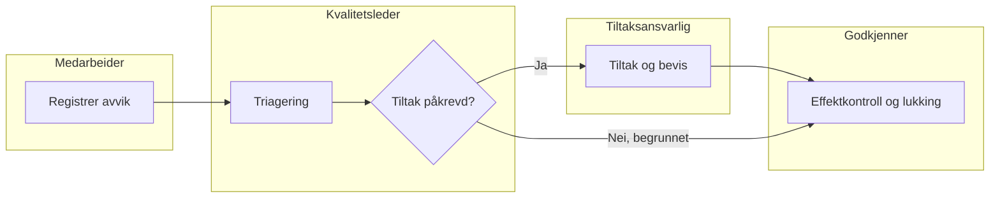

## Struktur for nodekonfigurasjon

```json
{
  "id": "node-review",
  "type": "humanTask",
  "label": "Vurder avvik",
  "visual": {"x": 420, "y": 160, "icon": "clipboard-check", "colorRole": "neutral"},
  "assignment": {"roleKey": "quality_manager", "fallbackRole": "system_owner"},
  "onClick": {"type": "openForm", "formKey": "SF16_AVVIK", "mode": "review"},
  "onEnter": {"type": "createTask", "dueInBusinessDays": 3},
  "onComplete": {"event": "iso.finding.triaged", "requiredFields": ["category", "priority", "assignee"]},
  "requirementLinks": [{"standard": "ISO9001", "edition": "2026", "clauseHint": "10.2"}],
  "version": "3.0"
}
```

## Kjørbar workflow – sentrale skiller

- **Node**: en UI- og prosessdefinisjon med typer og semantikk; klikkhendelse utfører bare eksplisitt tillatte handlinger.
- **Edge**: styrt overgang med betingelse `fieldEq`, `all`, `any`, `noError`, `approved`, ikke vilkårlig brukerkode.
- **ProcessDefinition**: versjonert designgraf, prosesseier, kontekst, relevant omfang, godkjenning, publishedAt.
- **ProcessInstance**: låst referanse til publisert `definitionId/version`, aktiv node, roller, oppgaver, tidshendelser, evidens, hendelseslogg.
- **UserTask**: en ordinær ProTop-oppgave med prosesskontekst, frist, autorisert behandlingsrolle og completionEvent.
- **FormSubmission**: lagrer `formId/version`, prosessversjon og gjeldende kravkoblinger.

### Publiseringsvalidator

1. Én eller flere dokumentert tillatte startnoder, alle tiltenkte sluttløp må nå gyldig slutt.
2. Ingen utilgjengelige noder, usikre automatiseringssløyfer eller beslutninger uten fullstendige grenregler/default.
3. Alle menneskelige oppgaver har rolle/assignee og definert tilstand ved fravær/ikke-tilgjengelig bruker.
4. Alle skjema- og dokumentreferanser peker til tilgjengelig godkjent versjon, eller er bevisst versjonslåst for historisk lesing.
5. Integrasjonshendelser må være idempotente, autoriserte og retry-/feiltolerante.
6. Ikke publiser dersom tilknyttede form-/kravreferanser er utgått eller ikke egnet for angitt omfang.
7. Oppdatert prosess påvirker ikke pågående instanser uten eksplisitt testet migrasjon og sporbar beslutning.

### Design- og bruksmodus

- **Designmodus:** nodeklikk åpner inspector, dra endrer koordinater og «Koble»-handling oppretter definert kant. Ingen produksjonsoppgaver opprettes.
- **Bruksmodus:** nodeklikk åpner sak/skjema/dokument; gjeldende oppgave er tydelig, mens fremtidige steg er låst eller lesbare basert på rolle.
- **Prosessoversikt:** navngitte utvalg av prosessdefinisjoner med eier, versjon, endret dato, kravdekning og antall aktive instanser.
- **Mobil:** fokusvisning («nå», «neste» og «tidligere»), pan/zoom som sekundær fullskjerm-funksjon.
