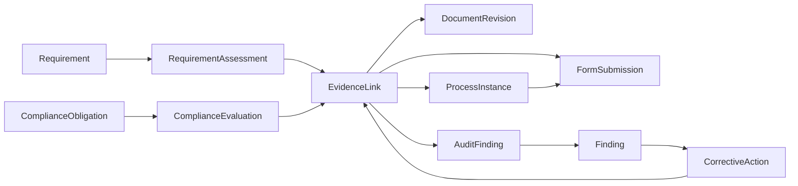

# 06 – Datamodell, API-kontrakter, tilganger og revisjonsspor

**Arkitekturføring:** Gjenbruk eksisterende ProTop-objekter og teknologistakk når en tilsvarende entitet finnes. Navn nedenfor er logiske domeneobjekter og SKAL tilpasses faktisk repo. Ikke opprett ny egen prosjekt-/ansatt-/kunde-master.

## Kjerneentiteter

| Entitet | Felt som alltid må finnes / koblinger |
|---|---|
| `ManagementSystem` | id, tenantId, scopeName, ownerId, orgUnitRefs, scopeText, activeStandards, status, version |
| `StandardEdition` | id, standardCode, edition, amendments, effectiveDate, supersedes, controlledSource |
| `Requirement` | id, standardEditionId/type, clause, heading, authorizedSummary, version, sourceRef |
| `RequirementAssessment` | id, scopeId, requirementId, relevance, status, assignee, rationale, assessedAt, nextReview, evidenceRefs |
| `ComplianceObligation` | id, type(LAW/CONTRACT/OTHER), legalSource, normalizedObligation, validFrom, jurisdiction, applicability, owner, nextReview |
| `ComplianceEvaluation` | id, obligationId, orgUnitId, evaluationMethod, outcome, assessor, timestamp, evidenceRefs, correctiveActions |
| `ProcessDefinition` | id, scopeId, revision, purpose, ownerId, nodes, edges, approval, state, publishedAt |
| `ProcessInstance` | id, definitionId, definitionVersion, contextRef, activeSteps, status, initiatedBy, timestamps |
| `ProcessEvent` | id, processInstanceId, stepId, eventType, eventPayloadHash, actor, occurredAt |
| `FormDefinition` | id, formKey, revision, fields, rules, approvals, state, publishedAt |
| `FormSubmission` | id, formId, formRevision, subjectRef, answers, owner, state, auditRef |
| `Document` | id, orgUnitId, docCode, title, docType, owner, accessClass, currentPublishedRevision |
| `DocumentRevision` | documentId, revision, contentHash, approvedBy, approvedAt, effectiveFrom, supersededAt |
| `Evidence` | id, evidenceType, objectRef, revisionRef, classification, createdBy, createdAt, hash, validity, scope |
| `Risk` | id, scopeId, category, context, hazardOrEvent, methodologyVersion, inherentAssessment, residualAssessment, controls, nextReview |
| `Opportunity` | id, scope, expectedBenefit, assumptions, owner, actions, targetResult |
| `EnvironmentalAspect` | id, activityRef, lifeCycleStage, aspect, impact, context, significanceMethodVersion, outcome, controls |
| `OHSHazard` | id, activity, hazardCategory, exposedRoles, assessment, controls, participation, accessClass |
| `Finding` | id, kind, severity, title, scope, affectedObjectRefs, state, assignee, occurredAt, accessClass |
| `RootCauseAnalysis` | id, findingId, method, evidence, causes, concludedAt, assessor |
| `CorrectiveAction` | id, findingIds, targetOutcome, owner, dueAt, state, evidenceRefs, verificationMethod, verifiedBy |
| `Objective` | id, domain, statement, owner, targetValue, unit, baseline, measurementPlan, period |
| `MetricObservation` | id, objectiveId, period, value, unit, source, method, accuracyClass |
| `AuditProgram` | id, period, scopeId, riskBasis, owner, planItems, approvedBy |
| `Audit` | id, programId, scope, criteria, auditorRefs, independence, evidence, findings, approvedReportRef |
| `ManagementReview` | id, reviewPeriod, agenda, inputSnapshots, participants, decisions, signedMinutes |
| `CompetenceRequirement` | id, roleRef, requiredLevel, validity, source, scope |
| `CompetenceRecord` | id, personRef, requirementId, evidence, validTo, assessedBy, state |
| `EmergencyScenario` | id, scope, hazard, responsibility, planRevision, exercisePlan, tests, findings |
| `CertificationRecord` | id, standardEdition, scope, certBody, validFrom, validTo, surveillanceDates, limitations |
| `AuditEvent` | id, tenantId, objectType, objectId, actorId, timestamp, action, previousHash, afterHash, reason, correlationId |

## Relasjons- og bevismodell



- `EvidenceLink` er egen mange-til-mange kobling mellom bevis og krav-/samsvarsvurderinger; en registrering kan støtte flere krav uten å kopieres.
- Bevis må bevare den spesifikke, godkjente versjonen av dokument eller kontroll som var gjeldende ved registreringen.
- `RequirementAssessment.status` er et vurderingsutfall (menneskelig attestering), aldri generert ved opplasting alene.
- Beslutninger må ha ansvarlig person med gjeldende fullmakt, og kunne spores til handling/verktøy/rettighet.

## API-eksempler (illustrative, ikke tvingende for valgt stack)

```http
GET    /api/iso/scopes/:scopeId/dashboard?from=&to=&standards=
GET    /api/iso/scopes/:scopeId/requirements?status=&edition=&owner=
POST   /api/iso/process-definitions
PATCH  /api/iso/process-definitions/:id/draft
POST   /api/iso/process-definitions/:id/validate
POST   /api/iso/process-definitions/:id/submit-approval
POST   /api/iso/process-definitions/:id/publish
POST   /api/iso/process-instances
POST   /api/iso/process-instances/:id/tasks/:taskId/complete
GET    /api/iso/forms?formKey=&state=
POST   /api/iso/form-submissions
POST   /api/iso/findings
POST   /api/iso/findings/:id/triage
POST   /api/iso/findings/:id/actions
POST   /api/iso/findings/:id/verify-effect
POST   /api/iso/findings/:id/close
POST   /api/iso/risks
POST   /api/iso/environmental-aspects
POST   /api/iso/audits
POST   /api/iso/management-reviews
POST   /api/iso/evidence/:id/requirements
GET    /api/iso/analytics/:metricKey?scopeId=&from=&to=&filters=
```

Alle skriveoperasjoner: valider auth, tenant, objekt- og feltrettigheter på serveren; idempotencyKey / optimistic version, immutable auditlogg, relevante domenehendelser. Er det eksisterende GraphQL/Firebase stack, realiser tilsvarende via valgt backend, ikke nødvendigvis REST.

## Rolle-/tilgangsmatrise (utgangspunkt)

| Rolle | Lese | Registrere | Vurdere/lukke | Designe/publisere | Sensitive HMS |
|---|---|---|---|---|---|
| Systemadministrator | Avgrenset av scope | Ja | Ikke automatisk fagfullmakt | Teknisk forvaltning | Nei som standard |
| Øverste ledelse | Autoriserte områder | Ja | Ledelsesgodkjenninger | Godkjenne policy/prosess | Kun konkret behov |
| Kvalitets-/HMS-leder | Relevant scope | Ja | Ja etter delegering | Prosesseier ved rolle | Etter særskilt tilgang |
| Prosesseier | Egen prosess | Ja | Egen fullmakt | Utkast og sending | Nei som standard |
| Prosjektleder | Egne prosjekter | Ja | Prosjektfunn etter rolle | Prosjektmaler hvis tillatt | Strengt behovsprøvd |
| Ansatt | Publiserte relevansstyrte deler | Ja | Egne tildelte oppgaver | Nei | Kun egen autorisert sak |
| Verneombud/ansattrepresentant | Relevant medvirkningsinnhold | Ja | Definerte vurderingsroller | Nei | Etter formål/lovlig behov |
| Ekstern revisor | Tidsstyrt godkjent utsnitt | Nei | Nei | Nei | Kun eksplisitt sladdet/avgrenset |

**Viktig:** Konserneier gir ikke automatisk tilgang til alle underselskapers ansatte eller sensitive funn. Feltklassifisering, dokumentklassifisering og forretningsobjekt må alle kontrolleres.

## Domenetilstandsmaskiner

- `ProcessDefinition`: DRAFT→IN_REVIEW→APPROVED→PUBLISHED→SUPERSEDED/ARCHIVED; REJECTED→DRAFT.
- `Finding`: REGISTERED→TRIAGE→ASSESSED→IN_CORRECTION/IN_ACTION→EFFECT_CHECK→CLOSED; reopen→ASSESSED etter manglende effekt.
- `CorrectiveAction`: OPEN→ASSIGNED→IN_PROGRESS→SUBMITTED_FOR_VERIFICATION→VERIFIED / RETURNED.
- `RequirementAssessment`: NOT_ASSESSED→IMPLEMENTING→EVIDENCE_AVAILABLE→INTERNALLY_VERIFIED; hvor som helst→REASSESSMENT_REQUIRED ved påvirkende endring.
- `DocumentRevision`: DRAFT→REVIEW→APPROVED→PUBLISHED→SUPERSEDED; historikk irreversibel uten ny hendelse.
- `Audit`: PLANNED→RUNNING→REPORT_DRAFT→APPROVED→FOLLOW_UP→CLOSED.

## Eksempel event-kontrakter

```json
{
  "eventId": "evt_1", "type": "iso.finding.created", "tenantId": "demo_only",
  "entityId": "finding_demo_1", "actorId": "person_demo_1", "occurredAt": "2026-10-22T12:00:00+02:00",
  "correlationId": "cmd_demo_1", "payloadVersion": 1,
  "context": {"scopeId":"scope_demo", "projectId":"project_demo"}
}
```

- Minst én outbox/inbox/idempotency-strategi for hendelser som trigger oppgave, varsel og integrasjon; aldri dobbel innsending ved retry.
- Filopplastinger knyttes til skannede og tilgangskontrollerte vedlegg med korrelasjon til registrering/revisjon.
- Sletting og retting følger dokumentert behandlingsgrunnlag, ikke «immutable for alltid» ved konflikt med personvernregelverk. Bruk lovlig retensjon, begrenset auditlogg og eventuelt sladdet revisjonsbevis.
